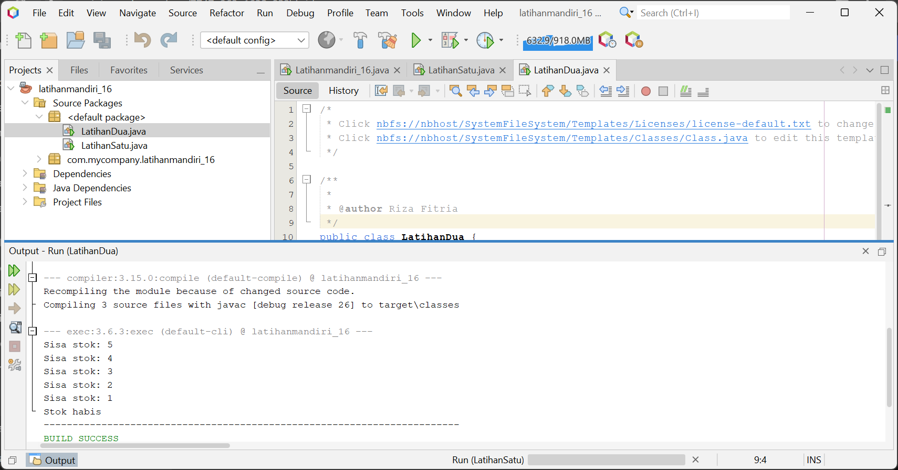
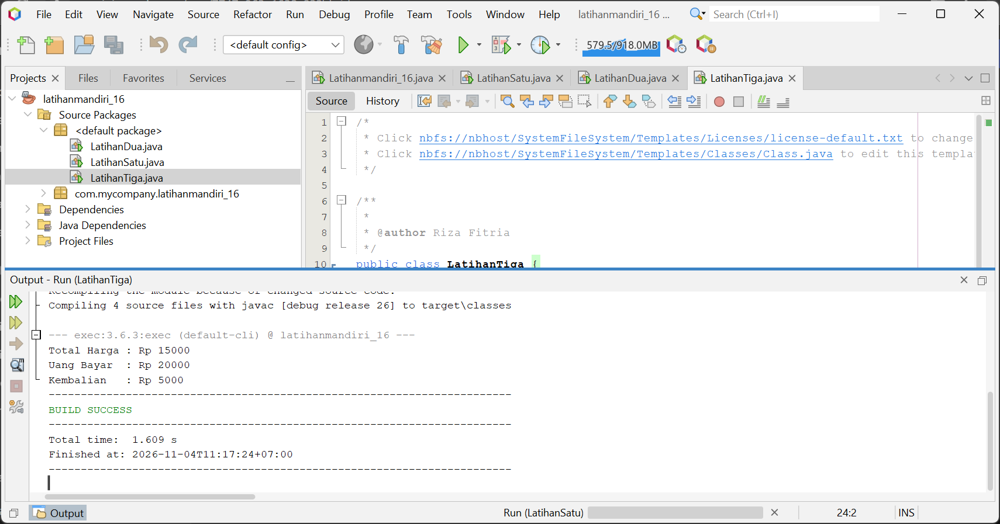
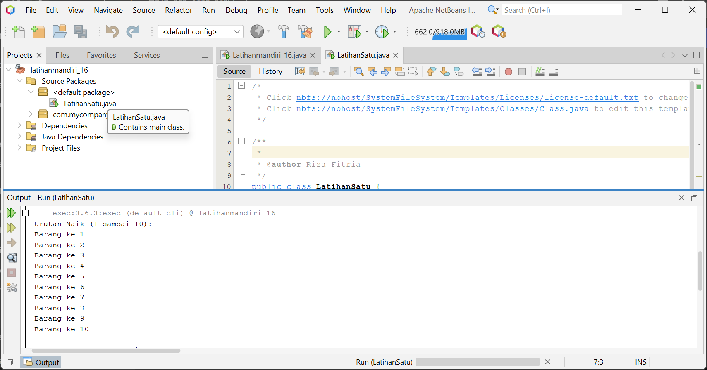

# Tugas Latihan Mandiri Java

Repository ini berisi penyelesaian dari 4 tugas latihan mandiri pemrograman Java menggunakan **Apache NetBeans**.

## 📋 Daftar File & Latihan

### 1. `LatihanSatu.java`
* **Deskripsi:** Program perulangan menggunakan `for`.
* **Fitur:**
  * Menampilkan urutan angka/barang dari **1 sampai 10** (urutan naik).
  * Menampilkan urutan angka/barang dari **10 turun ke 1** (urutan turun).

### 2. `LatihanDua.java`
* **Deskripsi:** Program simulasi pengurangan stok barang.
* **Fitur:**
  * Menggunakan perulangan `while`.
  * Stok awal bernilai 5 dan berkurang 1 demi 1 di setiap pengulangan.
  * Menampilkan pesan "Stok habis" setelah perulangan selesai.

### 3. `LatihanTiga.java`
* **Deskripsi:** Program pembuatan method dengan nilai kembalian (*return value*).
* **Fitur:**
  * Memiliki method `hitungKembalian(int uangBayar, int totalHarga)`.
  * Mengembalikan selisih antara `uangBayar` dan `totalHarga`.

### 4. `LatihanEmpat.java`
* **Deskripsi:** Program pembuatan method tanpa nilai kembalian (`void`).
* **Fitur:**
  * Memiliki method `tampilkanDaftarBarang(String namaBarang, int jumlahBeli)`.
  * Menampilkan rincian nama barang dan jumlah beli.

---

## 🛠️ Persyaratan System & Tools
* **JDK:** Java Development Kit (JDK 8 atau versi lebih baru)
* **IDE:** Apache NetBeans

---

## 🚀 Cara Menjalankan Kode
1. Clone atau download repository ini.
2. Buka **Apache NetBeans**.
3. Buat proyek Java baru atau buka file `.java` masing-masing latihan secara langsung.
4. Jalankan program dengan menekan **`Shift + F6`** (Run File) pada file yang ingin dieksekusi.

## Hasil Praktik Java - Apache NetBeans

### 1. Latihan Perulangan FOR

### 2. Latihan Perulangan WHILE

### 3. Latihan Method Kembalian

### 4. Latihan Method Daftar Barang

